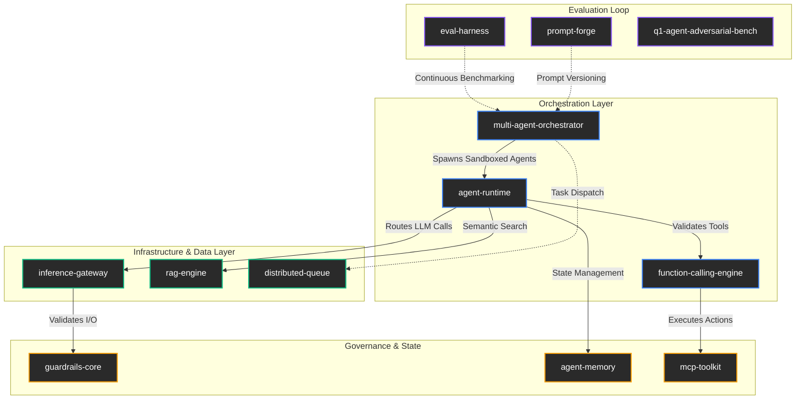

# Q1 AI Infrastructure Stack
**End-to-End Production-Grade AI Ecosystem**

> A robust, lock-free, and deterministic infrastructure for autonomous AI agents, multi-agent orchestration, and production RAG systems.

## 🏗️ Architecture Map

## 📦 The Ecosystem

### 🧠 1. Core Orchestration
- **[multi-agent-orchestrator](https://github.com/kreftamarcio/multi-agent-orchestrator)**: TypeScript framework for orchestrating cooperative LLM agents with fault tolerance, circuit breakers, and observable state machines.
- **[agent-runtime](https://github.com/kreftamarcio/agent-runtime)**: Lightweight AI agent execution runtime featuring sandboxed tool calls, resource limits, execution traces, and graceful termination.
- **[function-calling-engine](https://github.com/kreftamarcio/function-calling-engine)**: Robust LLM tool-use orchestration with JSON schema validation, retry policies, parallel execution, timeout management, and result aggregation.

### 🌐 2. AI Infrastructure & Data
- **[inference-gateway](https://github.com/kreftamarcio/inference-gateway)**: Multi-provider LLM routing with circuit breakers, cost-aware load balancing, streaming multiplexer, automatic fallback, and native OpenTelemetry observability.
- **[rag-engine](https://github.com/kreftamarcio/rag-engine)**: Production-grade RAG pipeline implementing hybrid search (dense + sparse), multi-strategy chunking, cross-encoder reranking, citation extraction, and hallucination scoring.
- **[distributed-queue](https://github.com/kreftamarcio/distributed-queue)**: Lock-free distributed task queue ensuring exactly-once delivery, dead-letter handling, priority lanes, and backpressure.

### 🛡️ 3. Governance, Safety & State
- **[guardrails-core](https://github.com/kreftamarcio/guardrails-core)**: AI safety layer performing I/O validation, PII redaction, prompt injection detection, topic boundary enforcement, and structured output validation via Zod.
- **[agent-memory](https://github.com/kreftamarcio/agent-memory)**: Long-term memory system for AI agents utilizing episodic, semantic, and procedural stores with temporal decay and relevance-recency retrieval tradeoffs.
- **[mcp-toolkit](https://github.com/kreftamarcio/mcp-toolkit)**: Framework for building MCP servers with automatic schema generation, auth middleware, rate limiting, health checks, and hot-reload dev mode.

### 🧪 4. Evaluation & Benchmarking
- **[eval-harness](https://github.com/kreftamarcio/eval-harness)**: LLM evaluation framework automating benchmarks, human-in-the-loop scoring, regression detection, and Pareto cost-quality analysis.
- **[prompt-forge](https://github.com/kreftamarcio/prompt-forge)**: Systematic prompt engineering toolkit providing evaluation pipelines, versioning, A/B testing, and regression detection.
- **[q1-agent-adversarial-bench](https://github.com/kreftamarcio/q1-agent-adversarial-bench)**: Open, adapter-based adversarial benchmark targeting agent security, verification, replay, and bounded self-improvement.

## 🚀 Key Engineering Principles
1. **Contracts First**: Zod schemas define every boundary. Everything else is implementation detail.
2. **Fail Explicitly**: Partial success > silent failure. Every error has a strict code, phase, and cause.
3. **Zero Any**: Enforced by `strictTypeChecked` ESLint. No escape hatches in production code.
4. **Observe Everything**: If it's not in the trace (OpenTelemetry), it didn't happen.

---
*Architected and maintained by [Marcio Krefta Fontella](https://github.com/kreftamarcio)*
