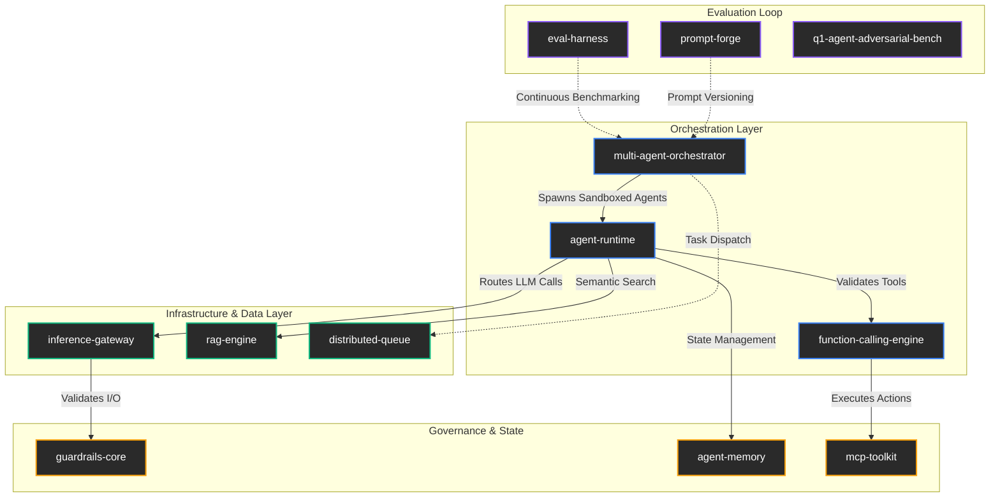

# Q1 AI Infrastructure Stack
**End-to-End Production-Grade AI Ecosystem**

> A robust, lock-free, and deterministic infrastructure for autonomous AI agents, multi-agent orchestration, and production RAG systems unified in **[q1-agent-stack](https://github.com/kreftamarcio/q1-agent-stack)**.

## 🏗️ Architecture Map

## 📦 Unified Monorepo Ecosystem

All core packages, agent runtimes, and RAG engines are unified in **[q1-agent-stack](https://github.com/kreftamarcio/q1-agent-stack)**:

- **Orchestration**: [`@q1digital/multi-agent-orchestrator`](https://github.com/kreftamarcio/q1-agent-stack/tree/main/packages/agents/multi-agent-orchestrator) · [`@q1digital/agent-runtime`](https://github.com/kreftamarcio/q1-agent-stack/tree/main/packages/agents/agent-runtime)
- **Governance & Safety**: [`@q1digital/guardrails-core`](https://github.com/kreftamarcio/q1-agent-stack/tree/main/packages/security) · [`@q1digital/agent-memory`](https://github.com/kreftamarcio/q1-agent-stack/tree/main/packages/agents/agent-memory)
- **Infrastructure & RAG**: [`@q1digital/rag-engine`](https://github.com/kreftamarcio/q1-agent-stack/tree/main/packages/rag) · [`@q1digital/inference-gateway`](https://github.com/kreftamarcio/q1-agent-stack/tree/main/packages/mlops)

---
*Architected and maintained by [Marcio Krefta Fontella](https://github.com/kreftamarcio)*
