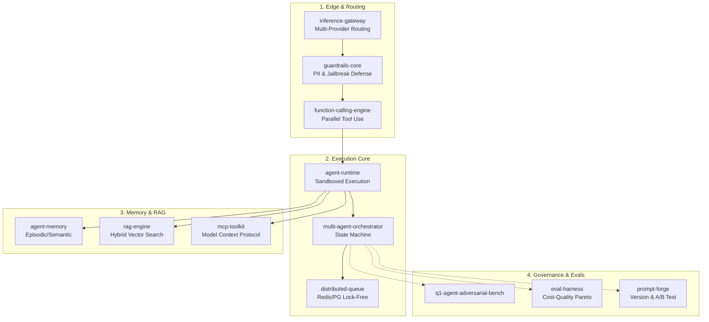

<div align="center">
  
  
  
  
</div>

# 🚀 Marcio Krefta
### Building AI-native tooling, from problem to deploy.

Focusing on **Loop Engineering, Multi-Agent Systems, and Prompt Infrastructure**. I build deterministic, observable, and highly reliable systems over probabilistic LLM layers.

---

## 🌌 The Q1 Agent Platform (Unified AI Ecosystem)

My open-source work forms a complete, interoperable **AI Agent Operating Core**. Every module is built with TypeScript, validated with Zod, and fully observable via OpenTelemetry.



## ⚡ Quickstart: The Agent Stack in 30 Seconds

Assemble a secure, observable agent pipeline seamlessly:

```typescript
import { InferenceGateway } from "@kreftamarcio/inference-gateway";
import { Guardrails } from "@kreftamarcio/guardrails-core";
import { FunctionEngine } from "@kreftamarcio/function-calling-engine";
import { AgentMemory } from "@kreftamarcio/agent-memory";

// 1. Initialize Multi-Provider Router with Failover (Groq -> Claude -> OpenAI)
const gateway = new InferenceGateway({ primary: 'groq', fallback: 'anthropic' });

// 2. Wrap with PII Redaction and Prompt Injection Detection
const safeGateway = new Guardrails(gateway).withPIIRedaction().withJailbreakDetection();

// 3. Attach Sandboxed Tools & Long-Term Memory
const engine = new FunctionEngine({ tools: [weatherTool, dbQueryTool] });
const memory = new AgentMemory({ provider: 'qdrant', similarity: 'cosine' });

// 4. Execute
const result = await engine.execute(safeGateway, "What's the revenue trend in Q3?", { memory });
```

---

## 🏆 Core Projects

### 🧠 Intelligence & RAG
- 🔍 **[rag-engine](https://github.com/kreftamarcio/rag-engine)**: Hybrid search (dense + sparse), multi-strategy chunking, cross-encoder reranking, and hallucination scoring.
- 💾 **[agent-memory](https://github.com/kreftamarcio/agent-memory)**: Long-term memory system for AI agents (episodic, semantic, procedural) with temporal decay and importance scoring.
- 🔌 **[mcp-toolkit](https://github.com/kreftamarcio/mcp-toolkit)**: Framework for building Model Context Protocol (MCP) servers with automatic schema generation and auth middleware.

### ⚙️ Orchestration & Execution
- 🔄 **[multi-agent-orchestrator](https://github.com/kreftamarcio/multi-agent-orchestrator)**: TypeScript framework for orchestrating cooperative LLM agents with fault tolerance and circuit breakers.
- 🛠️ **[function-calling-engine](https://github.com/kreftamarcio/function-calling-engine)**: Robust LLM tool-use orchestration: JSON schema validation, retry policies, parallel execution.
- 🚀 **[agent-runtime](https://github.com/kreftamarcio/agent-runtime)**: Lightweight AI agent execution runtime: sandboxed tool calls, resource limits, and execution traces.
- ⚡ **[inference-gateway](https://github.com/kreftamarcio/inference-gateway)**: Multi-provider LLM routing with circuit breakers, cost-aware load balancing, and native OpenTelemetry.
- 📨 **[distributed-queue](https://github.com/kreftamarcio/distributed-queue)**: Lock-free distributed task queue: exactly-once delivery, dead-letter handling, priority lanes.

### 🛡️ Safety & Benchmarks
- 🛑 **[guardrails-core](https://github.com/kreftamarcio/guardrails-core)**: AI safety layer: I/O validation, PII redaction, prompt injection detection, structured output validation (Zod).
- ⚖️ **[eval-harness](https://github.com/kreftamarcio/eval-harness)**: LLM evaluation framework: automated benchmarks, regression detection, Pareto cost-quality analysis.
- 🛡️ **[q1-agent-adversarial-bench](https://github.com/kreftamarcio/q1-agent-adversarial-bench)**: Adversarial benchmark for agent security, verification, replay, and bounded self-improvement.
- 🧪 **[prompt-forge](https://github.com/kreftamarcio/prompt-forge)**: Prompt engineering toolkit with evaluation pipelines, versioning, A/B testing, and regression detection.

---

<div align="center">
  <i>Every repository follows strict Open Source Security Foundation (OSSF) guidelines, SLSA Level 3 supply-chain security, and semantic versioning.</i>
</div>
