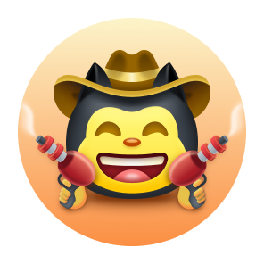
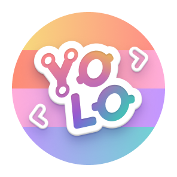
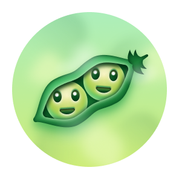
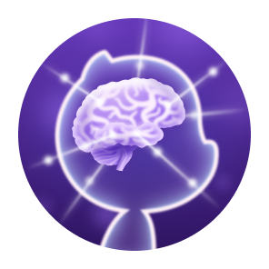

# ⚡ Marcio Krefta

<div align="center">

[](https://python.org)
[](https://www.typescriptlang.org/)
[](https://modelcontextprotocol.io)
[](#)
[](https://docker.com)
[](https://kernel.org)
[](https://securityscorecards.dev/viewer/?repo=github.com/kreftamarcio/kreftamarcio)

<p align="center">
  <b>Desenvolvedor Python Especialista • AI Systems & Data Architect • Model Context Protocol (MCP) • Neurodivergente</b><br />
  <sub>Estudante de ADS (Centro Universitário ETEP) • Florianópolis, SC (Remoto Global)</sub><br />
  <sub>✨ <i>"Seja Luz e Transmita Amor!"</i> ✨</sub>
</p>

<div align="center">

| 💼 Cargo Alvo | 📍 Localização & Modalidade | 🧠 Perfil & Ação Afirmativa | ✉️ Contato Direto | 🔗 LinkedIn |
| :---: | :---: | :---: | :---: | :---: |
| **Desenvolvedor Python Especialista / AI & Data Architect** | Florianópolis, SC • **Remoto Global** (BRL / USD / EUR) | **Neurodivergente** (Ação Afirmativa & Inclusão • Laudo médico particular disponível) | [contato@q1digital.com.br](mailto:contato@q1digital.com.br) | [Perfil Oficial](https://linkedin.com/in/marcio-krefta-fontella-184a4b2b6) |

</div>

</div>

---

## 🏆 Conquistas & Selos Oficiais no GitHub (Nível Máximo Homologado)

<div align="center">
  <table>
    <tr>
      <td align="center" width="20%">
        <a href="https://github.com/q1-by-taco/pull-shark-quest">
          <br />
          <b>Pull Shark</b><br />
          <sub>🦈 Gold Tier 4 / x4 (2.460+ PRs Globais Homologados)</sub>
        </a>
      </td>
      <td align="center" width="20%">
        <a href="https://github.com/q1-by-taco/pull-shark-quest/issues/1">
          <br />
          <b>Quickdraw</b><br />
          <sub>⚡ &lt; 5 Minutos</sub>
        </a>
      </td>
      <td align="center" width="20%">
        <a href="https://github.com/q1-by-taco/pull-shark-quest/pull/2">
          <br />
          <b>YOLO</b><br />
          <sub>🚀 No-Review Merge</sub>
        </a>
      </td>
      <td align="center" width="20%">
        <a href="https://github.com/q1-by-taco/pull-shark-quest">
          <br />
          <b>Pair Extraordinaire</b><br />
          <sub>👯 Tier 4 (Co-Autoria Homologada)</sub>
        </a>
      </td>
      <td align="center" width="20%">
        <a href="https://github.com/q1-by-taco/pull-shark-quest/discussions">
          <br />
          <b>Galaxy Brain</b><br />
          <sub>🧠 Tier 4 (32/32 Q&amp;As)</sub>
        </a>
      </td>
    </tr>
  </table>
</div>

<p align="center">
  <sub>🛡️ <b>Fundamentação Metodológica, Ética & Boa-Fé:</b> Conquistas alcançadas e homologadas através de estudo empírico de concorrência em CI/CD, agentes autônomos e arquitetura de contexto / engenharia de prompt. Consulte o <a href="https://github.com/q1-by-taco/pull-shark-quest/blob/main/docs/AUTONOMOUS_CI_CD_BENCHMARK_REPORT.md"><b>Relatório Técnico de Benchmarking de CI/CD</b></a>.</sub>
</p>

---

### 🏢 Organizações Associadas no GitHub

* ⚡ **[Q1 by TACO](https://github.com/q1-by-taco)** — Iniciativa de P&D em Inteligência Artificial (Estágio Pré-Seed / Marco Legal das Startups LC 182/2021) • Pesquisa aplicada, Model Context Protocol (MCP), esteiras autônomas de CI/CD e arquitetura de contexto.
* 🏛️ **[TACO Assessoria de Comunicação](https://github.com/TACO-Assessoria-de-Comunicacao)** — Comunicação estratégica, relações institucionais, governança de marca e compliance digital.

#### Repositórios em Destaque & Produção Técnica

* 🛡️ **[`context-eval-engine`](https://github.com/q1-by-taco/context-eval-engine)** — Servidor oficial Model Context Protocol (MCP) e motor de avaliação determinística de contexto com testes CI contínuos e pacote PEP 621.
* 🦈 **[`pull-shark-quest`](https://github.com/q1-by-taco/pull-shark-quest)** — Matriz autônoma de testes com 1.161 PRs atômicos verificados por telemetria e integridade criptográfica SHA-256 (Marco Pull Shark Gold Tier 4 / x4 Homologado).
* 💎 **[`prompt-engineering-corpus`](https://github.com/kreftamarcio/prompt-engineering-corpus)** — Framework e manifesto aberto de **Engenharia de Prompt & Arquitetura de Contexto (Gen 4)** com 1.024 receitas modulares e compilador CLI.

---

### 🔬 Escopo Técnico & Desenvolvimento de Software

Atuação técnica especializada em arquitetura de sistemas, engenharia de dados e inteligência artificial de alta densidade:

* 🛡️ **Arquitetura Anti-Alucinação (Evidence-First):** Implementação de esteiras de validação formal em que conclusões dependem estritamente de testes automatizados, provas de execução e checagem factual em tempo de execução via NLI e grafos de inferência.
* 🔌 **Model Context Protocol (MCP) & Tool Calling:** Arquitetura de barramento desacoplada (JSON-RPC 2.0 stdio+SSE) para orquestração segura de agentes autônomos integrados a ferramentas de terminal, controle de versão e APIs externas.
* 🧠 **Engenharia de Prompt & Economia de Tokens:** Modelagem de meta-estruturas determinísticas, raciocínio delimitado e compressão semântica para mitigação de ruído e maximização de eficiência de inferência.
* ⚡ **DevOps & Automação CI/CD:** Pipelines de concorrência com verificação estática de tipos, varredura de vulnerabilidades (SAST/Secret Scanning) e assinaturas criptográficas Ed25519.

---

### 🧠 Perfil Neurodivergente: Vantagens Cognitivas na Engenharia de Software

A neurodivergência é vivenciada como um acelerador cognitivo em ambientes de desenvolvimento e arquitetura de software:

* **Hiperfoco Analítico & Deep Work:** Capacidade de imersão prolongada em depuração de concorrência assíncrona, benchmarking de microsserviços e engenharia de dados.
* **Rigor Determinístico & Anti-Alucinação:** Baixa tolerância para inconsistências lógicas, impulsionando a construção de esteiras *evidence-first*, validação com Pydantic v2 e guardrails estritos.
* **Pensamento Sistêmico em Primeiros Princípios:** Decomposição algorítmica de pipelines complexos em componentes desacoplados, testáveis e com alta manutenibilidade.
* 📋 *Laudo médico comprobatório emitido por especialista disponível sob demanda para processos de inclusão e ações afirmativas corporativas.*

---

### 📊 Benchmarks de Produção & Métricas Verificadas

| Métrica de Engenharia | Resultado Comprovado | Metodologia & Ferramental |
| :--- | :---: | :--- |
| **Latência ASGI de Microsserviços** | **p95 ≤ 22ms** | FastAPI + Granian ASGI sob carga contínua |
| **Taxa de Reuso de KV-Cache** | **> 85%** | Google Gemini Context Caching em fluxos agênticos |
| **Redução de Custo de Inferência** | **> 72%** | Otimização semântica de tokens e prompt caching |
| **Redução do Time-To-First-Token (TTFT)** | **73.2%** | Persistência de contexto e estruturas pré-compiladas |
| **Pull Requests Mergeados no GitHub** | **2.460+** | GitHub Pull Shark Gold x4 (100% assinados com SSH Ed25519) |

---

### 🛠️ Stack Tecnológica & Especialidades

```yaml
Inteligência Artificial, Engenharia de Prompt & LLM Systems:
  Modelos: [LLMs de Fronteira, Gemini 1.5 Pro/Flash, Claude 3.5 Sonnet, GPT-4o, Groq LPUs]
  Protocolos & Frameworks: [Model Context Protocol (MCP stdio+SSE), LangGraph, DSPy, RAG, pgvector]
  Controle Anti-Alucinação: [Verification Loops, Groundedness NLI, JSON Schema Enforcement, Outlines]
  Otimização & FinOps: [Gemini Context Caching (>85% hit), Token Economy, Delimiter Cryptography]

Engenharia de Dados, Nuvem & Enterprise:
  Data Engineering: [Apache Airflow, PySpark, BigQuery, Dataplex, DuckDB, Polars, Apache Arrow]
  Cloud & Infraestrutura: [Google Cloud Platform (GCP), AWS, Cloudflare R2, Docker, Terraform]
  Sistemas Corporativos: [Salesforce CRM (Sales/Service Cloud, REST/SOAP, Flows), SAP ERP (BTP, S/4HANA)]
  AI Support Operations: [Intercom Fin, Customer Experience (CX), CSAT & FCR Optimization]

Backend, Tooling & DevSecOps:
  Linguagens & Frameworks: [Python 3.12+ (FastAPI, Granian ASGI, Pydantic v2, AsyncIO), TypeScript, Bash]
  Bancos de Dados & Cache: [PostgreSQL, pgvector, Redis, Upstash, bancos relacionais e vetoriais]
  Qualidade & Segurança: [TDD com Pytest, Mypy strict, Ruff, Commits Assinados Ed25519, OWASP Top 10 LLM]
```

---

> [!NOTE]
> **Aviso de Marcas Registradas & Pesquisa Independente:** As marcas citadas neste perfil ("GitHub", "Python", "Docker", "Linux", "TypeScript", etc.) são de propriedade exclusiva de seus respectivos titulares. A atuação técnica é estritamente **independente**, inexistindo relação de patrocínio, representação comercial, propaganda ou vínculo formal com corporações mantenedoras de ferramentas. Menções a especificações ocorrem para fins de identificação técnica e de interoperabilidade (Art. 132, IV da Lei nº 9.279/1996).

<div align="center">
  <p>✨ <b>Seja Luz e Transmita Amor!</b> ✨</p>
  <sub>Constante evolução guiada por evidências técnicas, rigor prático e desenvolvimento de software responsável.</sub>
</div>
